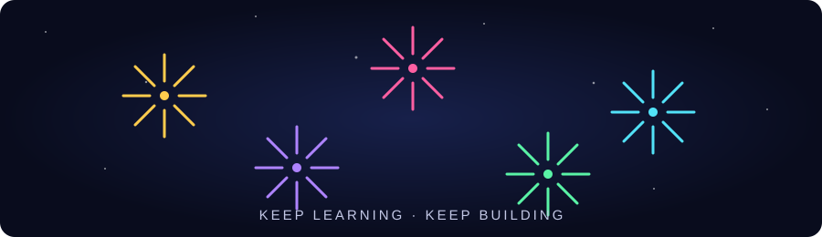

<div align="center">


<br />



<br />

<a href="https://github.com/chantharith-NY/AMS-ADV-Assignment"></a>


</div>

---

## ✨ About this repository

**AMS-ADV-Assignment** is a workspace for assignment materials, experiments, and learning progress. This README will be updated as the project grows.

## 🎯 Goals

- 📚 Organize assignment materials and solutions.
- 🧠 Practice problem-solving and technical skills.
- 💻 Document implementation, experiments, and results.
- 🚀 Track improvements through version control.

## 📁 Project structure

The repository is being initialized. Project files and instructions will be documented here as they are added.

## 🚀 Getting started

Clone the repository:

```bash
git clone https://github.com/chantharith-NY/AMS-ADV-Assignment.git
cd AMS-ADV-Assignment
```

See future assignment files for setup and usage instructions.

## 👨‍💻 Author

Created by [**@chantharith-NY**](https://github.com/chantharith-NY).

<div align="center">

### 🎆 Thanks for visiting!

**⭐ Star this repository if you find it interesting.**


</div>
